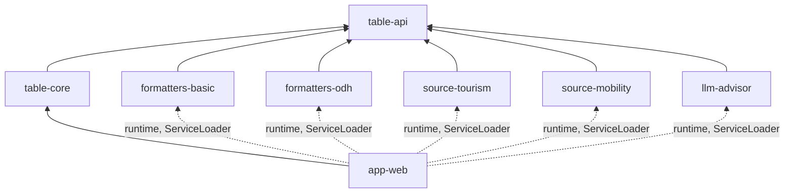

# Open Data Hub – Table Column Formatters

[](https://github.com/SebastianoDruda/open-data-hub-project/actions/workflows/ci.yml)
[](LICENSE)

A pluggable web table component that renders data from the [Open Data Hub](https://opendatahub.com/)
APIs and formats every column with **formatters** chosen by **configuration** or, when a column is not
configured, **suggested by an LLM**.

> Example: the component receives a column `temperature` with the samples `12.345, 8.1, -0.4`.
> The LLM suggests the pipeline `number(decimals=1) → unit(suffix="°C")` and the table shows `12.3 °C`.

*Design Challenge 1 – Software Architecture course, Free University of Bozen-Bolzano (Prof. Eduardo Guerra).*

> **Status:** project skeleton (milestone M0). See the [implementation plan](docs/implementation-plan.md).

## Goals

- Generate a web table from the data returned by an Open Data Hub API.
- Apply one or more formatters to the values of every column.
- Choose formatters from configuration or from an LLM suggestion.
- Add new formatters without changing existing code (pluggable architecture), with at least 5 general formatters.
- Justify the LLM strategy (prompting, performance, sustainability) and test it on different models.

## Architecture at a glance



The format of a column is resolved by a chain: **explicit configuration → cached suggestion → LLM
advisor → plain-text default**. The LLM receives a closed catalogue of formatters generated from
the plugins' annotations, so a new formatter is immediately available to it.

| Module | Role |
|---|---|
| [`table-api`](table-api) | Stable contract: formatter, data source and advisor interfaces, annotations, table model |
| [`table-core`](table-core) | Formatter registry, resolution chain, formatting pipeline |
| [`formatters-basic`](formatters-basic) | General formatters (number, unit, date/time, boolean, text, link, ...) |
| [`formatters-odh`](formatters-odh) | Open Data Hub specific formatters (multilingual text, coordinates, ...) |
| [`source-tourism`](source-tourism) | Adapter for the Tourism API |
| [`source-mobility`](source-mobility) | Adapter for the Mobility API |
| [`llm-advisor`](llm-advisor) | LLM formatting advisor (LangChain4j) – the only module that depends on an LLM library |
| [`app-web`](app-web) | Composition root: web server and table page |

More: [architecture overview](docs/architecture/overview.md) · [decision records](docs/adr/README.md).

## Getting started

Requirements: **JDK 21+** (Maven is provided by the wrapper).

```bash
git clone https://github.com/SebastianoDruda/open-data-hub-project.git
cd open-data-hub-project
./mvnw verify
```

How to run the web application and configure the LLM provider will be documented in milestones M5–M6.

## Repository layout

```
├── table-api/ table-core/            contract and core
├── formatters-*/ source-*/ llm-advisor/   plugins
├── app-web/                          composition root
├── docs/
│   ├── architecture/                 architecture overview
│   ├── adr/                          architecture decision records
│   ├── ai-log/                       prompts and AI interactions (required by the assignment)
│   └── implementation-plan.md        milestones M0–M8
└── .github/                          CI, Dependabot, issue / PR templates
```

## Contributing

See [CONTRIBUTING.md](CONTRIBUTING.md): issue → branch → small Conventional Commits → pull request
with review and green CI.

## Use of AI

AI assistants are used as programming assistants. As required by the assignment, every prompt and
interaction is recorded in [`docs/ai-log`](docs/ai-log/README.md), and the team reviews and
understands all the committed code.

## Team

- Sebastiano Druda ([@SebastianoDruda](https://github.com/SebastianoDruda))
- Jacob Wieser ([@wieserjac](https://github.com/wieserjac))
- Tom Springer ([@tom-spri](https://github.com/tom-spri))

## License

[MIT](LICENSE). Data from Open Data Hub is subject to the licenses stated by each dataset.
