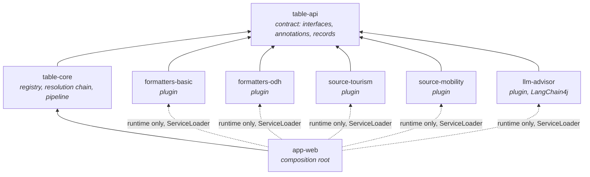
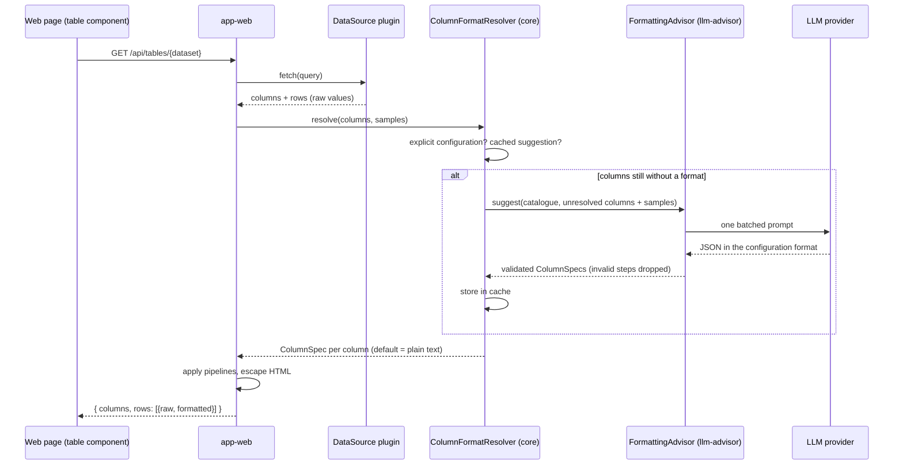

# Architecture overview

> Status: initial design, to be refined by the team. Every structural decision is recorded as an
> ADR in [`decisions/`](decisions/README.md); this page is the map that ties them together.

## 1. Problem

Open Data Hub exposes heterogeneous datasets (tourism, mobility, weather, ...). A generic table
component must show any of them and format every column properly: numbers with the right
precision and unit, dates, booleans, multilingual text, coordinates, links...

The formatting of a column is decided in this order:

1. **explicit configuration** written by a developer;
2. otherwise a **suggestion from an LLM**, which receives the column name, a few sample values
   and the catalogue of available formatters (e.g. `temperature` → `number(decimals=1)` → `unit(suffix="°C")`);
3. otherwise a safe **default** (plain text).

New formatters must be addable **without changing existing code** (Open-Closed Principle).

## 2. Quality attributes (priorities)

| Priority | Attribute | What it means here | Main tactic |
|---|---|---|---|
| 1 | **Extensibility** | Add a formatter or a data source without touching the core | Plugins discovered with `ServiceLoader`, metadata in annotations ([ADR-0003](decisions/0003-plugins-via-serviceloader-and-annotations.md)) |
| 2 | **Modularity / testability** | Each part testable in isolation, no hidden coupling | Maven + JPMS modules, star-shaped dependencies towards `table-api` ([ADR-0002](decisions/0002-java-maven-multi-module-jpms.md)) |
| 3 | **Sustainability / cost** | Few LLM calls, small prompts, smallest model that is good enough | One batched call per table, few samples, cache, suggestion reused as configuration ([ADR-0005](decisions/0005-llm-suggestion-uses-configuration-format.md)) |
| 4 | **Reliability** | A wrong or missing LLM answer never breaks the table | Closed catalogue, validation against the registry, fallback chain |
| 5 | **Security** | API values are untrusted input to the prompt and to the HTML | Prompt-injection defences, HTML escaping in one place (the renderer), API key only on the server ([ADR-0004](decisions/0004-server-side-formatting.md)) |

## 3. Modules

Rules (checked in code review now, and by an automated architecture test from milestone M1):

- every arrow points towards `table-api`, the most stable and abstract module (**Stable Dependencies**
  and **Stable Abstractions** principles);
- no cycles between modules (**Acyclic Dependencies Principle**);
- plugins never depend on each other or on `table-core`;
- only `llm-advisor` depends on an LLM library (**Common Reuse Principle**);
- `app-web` sees the plugins only at runtime, so it cannot reference their classes.

Expected position on the abstractness/instability graph:

| Module | Abstractness | Instability | Comment |
|---|---|---|---|
| `table-api` | high | ~0 | many incoming dependencies, mostly interfaces/annotations/records |
| `table-core` | low/medium | medium | depends on the API, used by the app |
| plugins | ~0 | ~1 | concrete classes nobody depends on: easy to change and to add |
| `app-web` | ~0 | 1 | composition root |

The real values will be measured and reported at the end of the project.

## 4. Main abstractions (to be designed in M1)

| Abstraction | Module | Role |
|---|---|---|
| `ColumnFormatter` | api | Strategy: transforms one value with given parameters |
| `@Formatter(id, description, params)` | api | Metadata of a formatter; used by the registry **and** to build the LLM catalogue |
| `FormatterStep`, `ColumnSpec` | api | Configuration: a column has a pipeline of one or more formatter steps |
| `DataSource` | api | Adapter: fetches a dataset and returns the table model |
| `FormattingAdvisor` | api | Suggests `ColumnSpec`s for unconfigured columns (implemented by `llm-advisor`) |
| `FormatterRegistry` | core | Discovers formatters, validates steps, exports the catalogue |
| `ColumnFormatResolver` | core | Chain of Responsibility: configuration → cache → advisor → default |

## 5. Runtime flow

## 6. Open questions

- Web framework for `app-web` (e.g. Javalin vs Spring Boot) – decide in M6.
- Configuration file format (JSON vs YAML) – decide in M4.
- Whether to try tool calling (the model previews a formatter on a sample before answering) as an
  experiment against the plain prompt – decide in M7 with data.
